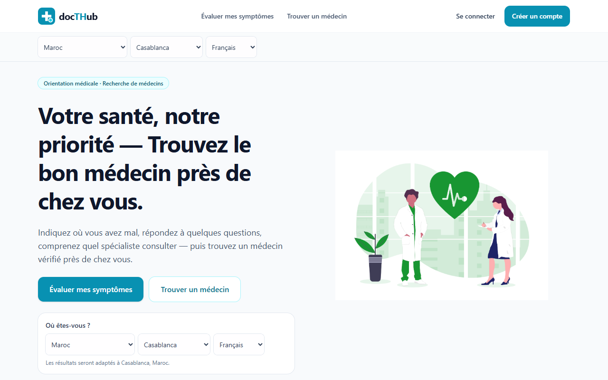
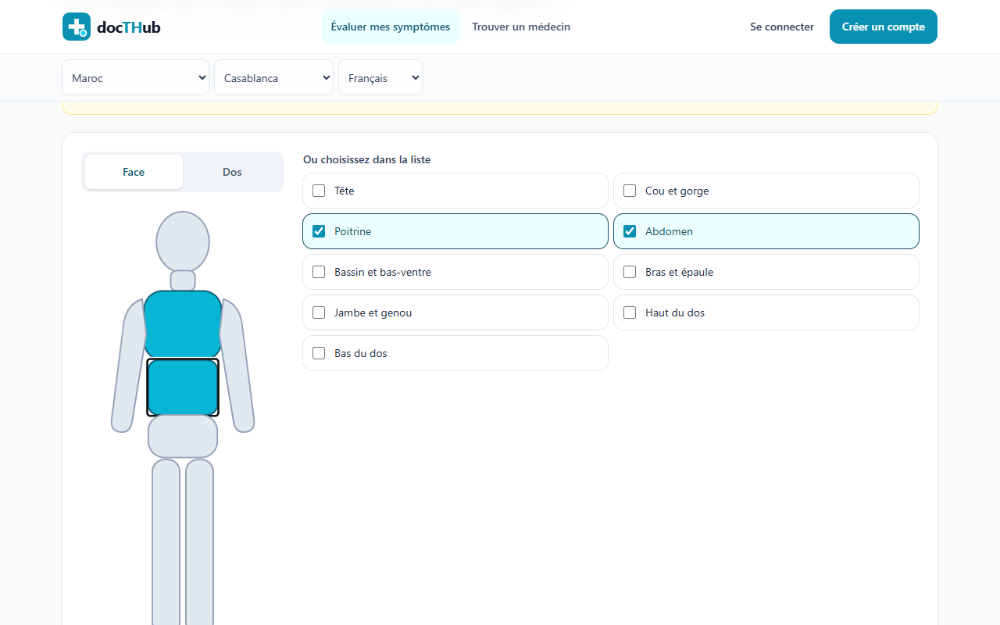
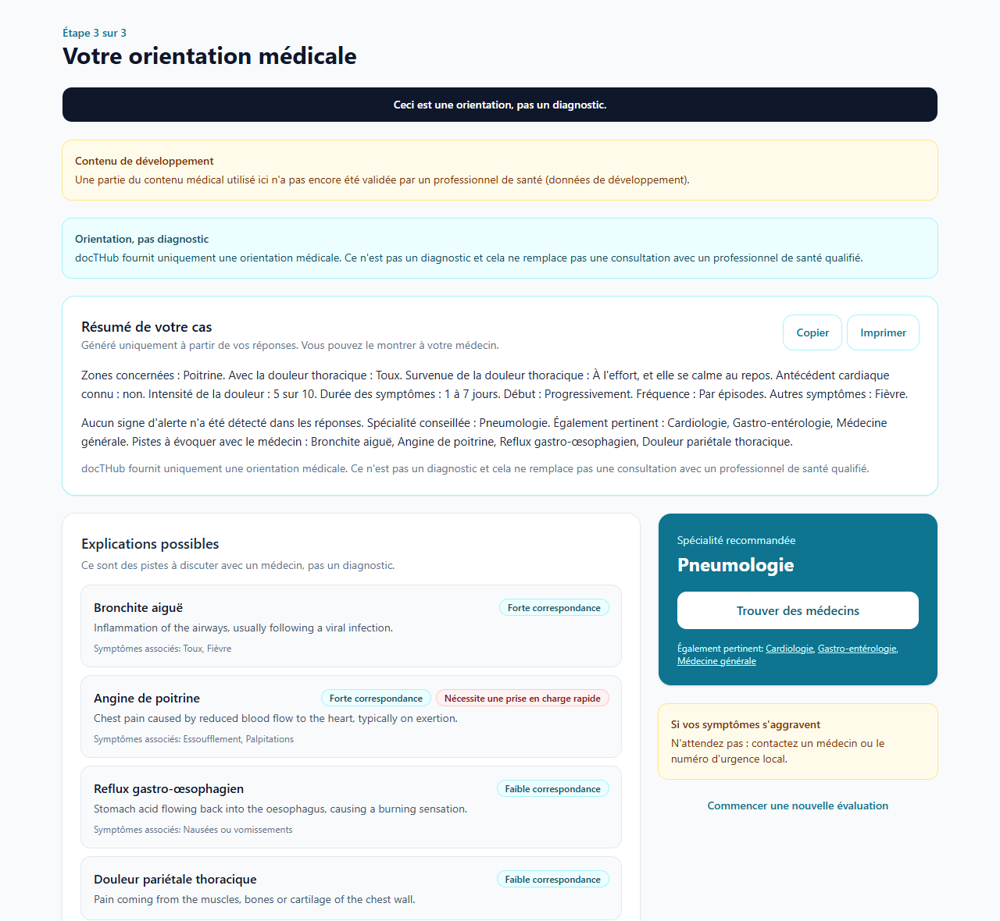
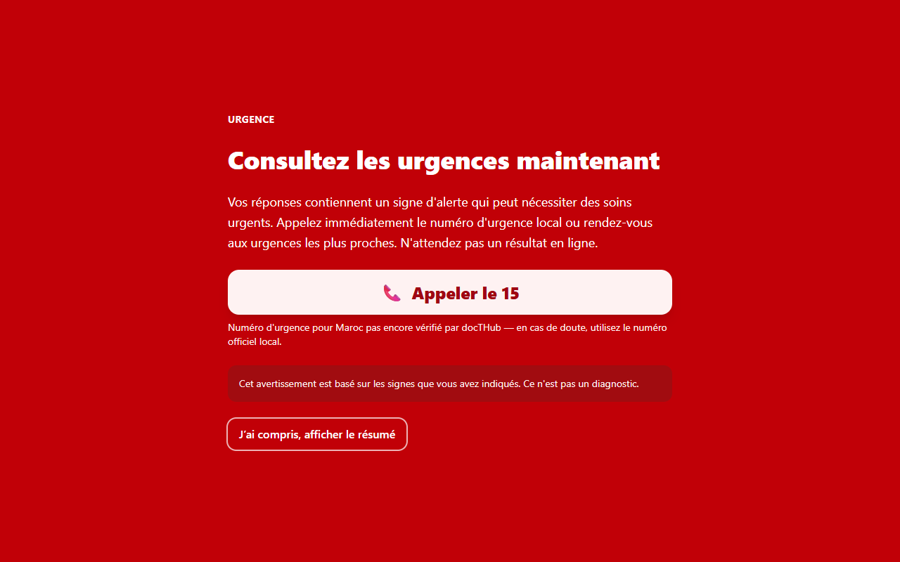
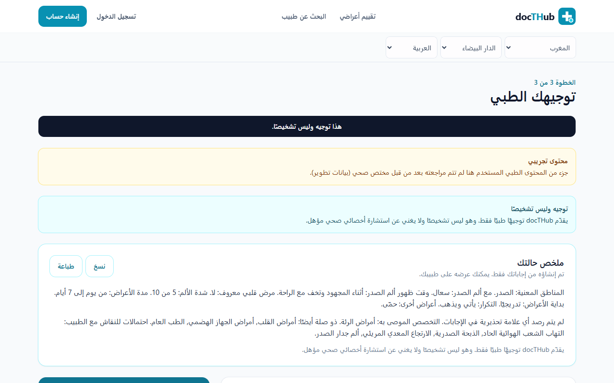
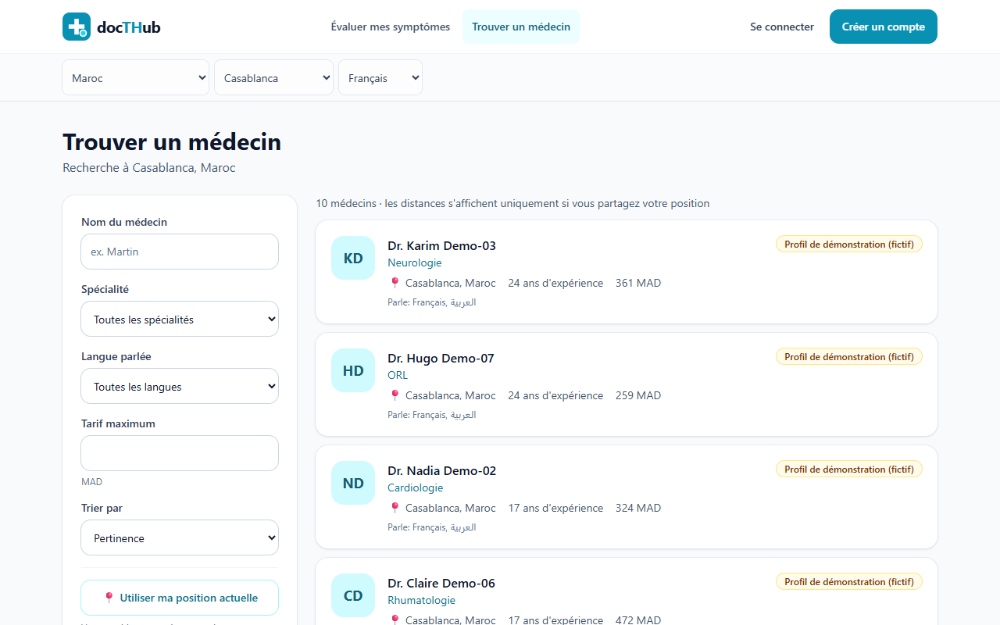
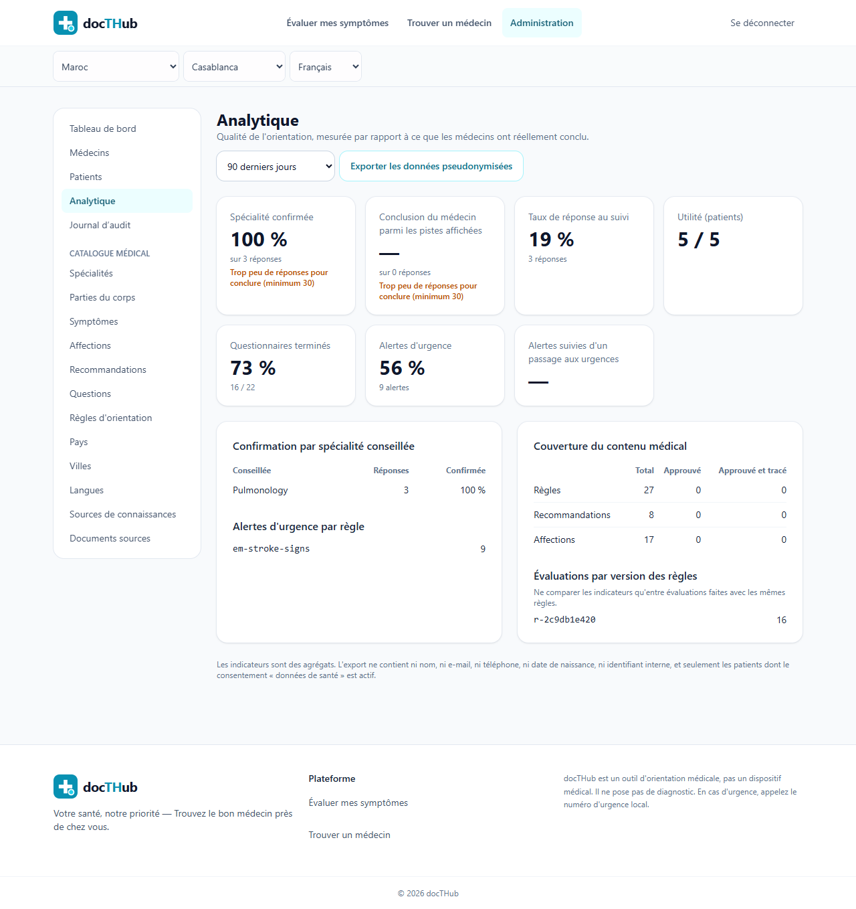
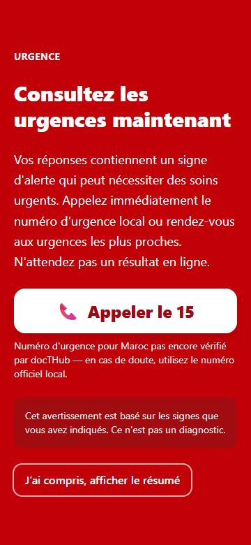
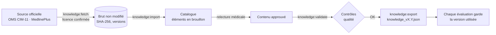
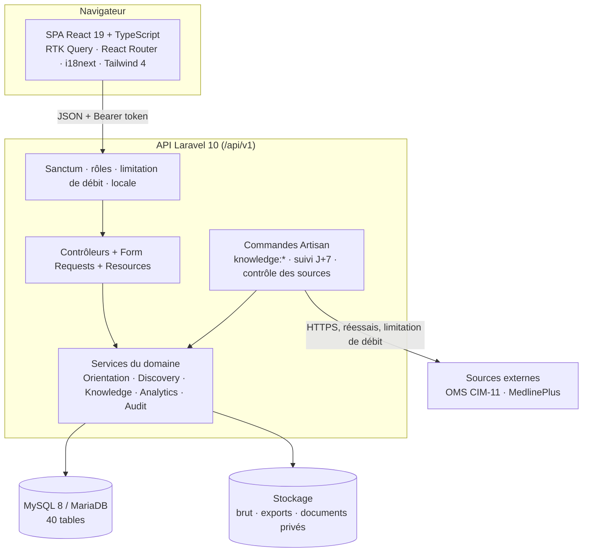

<div align="center">


# docTHub

**Votre santé, notre priorité : trouvez le bon médecin près de chez vous.**

Plateforme web d'**orientation médicale** et de **recherche de médecins**, multilingue (français, anglais, arabe).


-2ea44f)

</div>

> [!IMPORTANT]
> docTHub est un outil d'**orientation**, pas un dispositif médical : il ne pose **aucun diagnostic**.
> Le contenu médical fourni dans ce dépôt est un **jeu d'exemple non validé cliniquement**, et les médecins affichés sont **fictifs**.

---

## Sommaire

- [L'idée](#lidée)
- [Aperçu](#aperçu)
- [Fonctionnalités](#fonctionnalités)
- [Architecture](#architecture)
- [Points techniques notables](#points-techniques-notables)
- [Démarrage rapide](#démarrage-rapide)
- [Tests et qualité](#tests-et-qualité)
- [Structure du dépôt](#structure-du-dépôt)
- [Limites et suite](#limites-et-suite)

---

## L'idée

**Le problème.** Quand on a mal quelque part, on ne sait souvent pas **quel spécialiste consulter**, ni si la situation est **urgente**. On cherche alors ses symptômes sur Internet et l'on tombe sur des diagnostics anxiogènes et peu fiables.

**La réponse de docTHub.** Un parcours simple, en trois étapes :

1. **Montrer où l'on a mal** sur un schéma du corps, cliquable et utilisable au clavier.
2. **Répondre à quelques questions** : le questionnaire s'adapte aux zones et aux réponses précédentes.
3. **Recevoir une orientation**, avec :
   - les pistes à discuter avec un médecin ;
   - la spécialité conseillée ;
   - des conseils ;
   - un résumé du cas à montrer au médecin ;
   - une liste de **médecins vérifiés à proximité**.

**La règle d'or : la sécurité d'abord.** Si une réponse contient un signe d'alerte (douleur thoracique avec essoufflement, signes d'AVC…), le questionnaire **s'arrête immédiatement**. Un écran d'urgence plein écran affiche alors le numéro d'urgence du pays, cliquable.

**Pour qui ?** Les patients (avec ou sans compte), et une équipe d'administration qui gère le contenu médical, les médecins et la qualité des données.

---

## Aperçu

| Accueil | Schéma du corps |
|---|---|
|  |  |

| Résultat de l'orientation | Écran d'urgence |
|---|---|
|  |  |

| Arabe, de droite à gauche | Médecins à proximité (profils fictifs) |
|---|---|
|  |  |

| Administration : qualité de l'orientation | Mobile (360 px) : urgence |
|---|---|
|  |  |

---

## Fonctionnalités

### Côté patient
- **Vérificateur de symptômes :**
  - schéma du corps (face / dos), avec une liste équivalente pour les lecteurs d'écran ;
  - questionnaire dynamique, avec questions conditionnelles, barre de progression et retour arrière ;
  - **reprise d'une évaluation interrompue**.
- **Orientation :**
  - pistes classées par force de correspondance, spécialité conseillée, conseils ;
  - **sources affichées** ;
  - **bandeau « contenu non relu »** dès qu'un élément n'a pas été approuvé.
- **Résumé du cas** lisible, à copier ou imprimer pour le médecin.
- **Urgences :** règles prioritaires et écran plein écran avec le numéro du pays (lien `tel:`).
- **Recherche de médecins :** par pays, ville, spécialité, langue parlée et tarif, avec distance si l'utilisateur partage sa position, et carte OpenStreetMap.
- **Compte patient :**
  - favoris et historique des évaluations ;
  - **export de ses données** et **suppression du compte** ;
  - consentements explicites.
- **Suivi à 7 jours :** le patient peut indiquer ce que le médecin a réellement conclu. Le retour est structuré, sans texte libre.
- **Trois langues** (FR / EN / AR), avec **mise en page de droite à gauche** complète en arabe.

### Côté administration
- **Catalogue médical complet en CRUD :** spécialités, zones du corps, symptômes, affections, conseils, questions, règles, pays, villes, langues. Les traductions se saisissent dans les formulaires.
- **Circuit de relecture :** `draft → in_review → approved`, avec relecteur nommé et version. Une règle approuvée qui est modifiée repasse en relecture.
- **Médecins :** vérification, documents privés, photos.
- **Analyse :**
  - concordance entre la spécialité conseillée et celle consultée ;
  - taux d'urgence par règle, taux de réponse au suivi ;
  - couverture du contenu relu ;
  - aucune conclusion affichée sous 30 réponses.
- **Export pseudonymisé** des données : patients consentants uniquement, sans identifiant.
- **Journal d'audit :** qui a changé quoi et quand, avec l'ancienne et la nouvelle valeur, y compris pour les traductions, les liens et les actions en ligne de commande.

### Pipeline de connaissances médicales
Un circuit **traçable** pour alimenter la base avec des sources officielles : OMS CIM-11 et MedlinePlus de la NLM.



- **Aucun téléchargement** tant qu'une personne n'a pas confirmé la licence de la source ([docs/sources.md](docs/sources.md)).
- **Le brut est conservé tel quel**, avec son empreinte. Si une source change, les éléments approuvés qui la citent **repassent en relecture** : rien n'est écrasé.
- **Rien n'est inventé :** pas de gravité, de lien ni de règle créés automatiquement, et pas de traduction automatique. Les langues manquantes sont marquées.
- **Exports versionnés** du contenu approuvé. Chaque évaluation enregistre la version de connaissances utilisée, pour des analyses comparables.

---

## Architecture



| Couche | Technologies |
|---|---|
| **API** | Laravel 10, PHP 8.2, Sanctum (jetons), Form Requests, API Resources, Policies, Scheduler |
| **Base de données** | MySQL 8 / MariaDB 10.11, 40 tables, traductions polymorphes, suppressions douces |
| **Front-end** | React 19, TypeScript 5.9, Vite 7, Redux Toolkit + RTK Query, React Router 7, Tailwind CSS 4, i18next |
| **Tests** | PHPUnit (108 tests), Vitest + Testing Library (35 tests), parcours dans un vrai Chrome (playwright-core) |
| **CI** | GitHub Actions : tests API sur MySQL 8, typecheck, tests et build du front, rapport de qualité du contenu |

L'API expose **123 routes** sous `/api/v1`, documentées dans [docs/V2_API.md](docs/V2_API.md).

---

## Points techniques notables

<details open>
<summary><b>Moteur d'orientation par règles, avec priorité absolue aux urgences</b></summary>

- Les règles sont des **données**, éditables et relues en administration, et non du code. Elles reposent sur des opérateurs (`equals`, `in`, `gte`…), des clauses combinées et des conditions d'âge ou de sexe.
- **Ordre d'évaluation :**
  1. les règles d'urgence, qui interrompent tout ;
  2. le score des affections : zone × 1, symptôme × 2 en renfort seulement, règle × 3 ;
  3. les spécialités ;
  4. les conseils.
- Un symptôme générique (fièvre) **ne fait jamais apparaître** une affection sans rapport avec la zone choisie.
- Un `ContentGate` garantit qu'en production **seul le contenu approuvé** est utilisé. Exception volontaire : une règle d'urgence s'applique même avant relecture, pour ne jamais manquer un signe d'alerte.
</details>

<details>
<summary><b>Traçabilité et qualité des données médicales</b></summary>

- **Empreintes SHA-256** de chaque document source, avec historique des versions. Une source modifiée renvoie automatiquement en relecture les éléments qui la citent.
- **`knowledge:validate`** échoue (code de sortie 1) si :
  - un lien est cassé ;
  - un élément approuvé n'a pas ses 3 langues, sa source, son relecteur ou sa version ;
  - un code est en double ;
  - une valeur est hors bornes ;
  - une règle d'urgence n'a pas de relecteur.
- **Instantanés déterministes** du contenu approuvé : un même contenu donne toujours la même empreinte, ce qui permet de dater chaque évaluation par version de connaissances.
- **Versions du questionnaire et des règles** enregistrées sur chaque évaluation : on ne compare que ce qui est comparable.
</details>

<details>
<summary><b>Sécurité et vie privée</b></summary>

- **Authentification :** Sanctum avec révocation des jetons, rôles (`patient`, `admin`), policies sur les évaluations, accessibles par UUID et utilisables sans compte.
- **Limitation de débit** par IP et par e-mail sur l'authentification.
- **Protection SSRF** du téléchargement de sources : http(s) public uniquement, adresses privées refusées, redirections revérifiées à chaque saut.
- **Données personnelles :**
  - date de naissance **chiffrée** ;
  - consentements versionnés ;
  - export des données et suppression du compte (anonymisation) ;
  - export analytique **pseudonymisé** (HMAC, tranche d'âge, semaine) limité aux patients consentants.
- **Journal d'audit** des actions d'administration et des commandes, avec ancienne et nouvelle valeur.
- **Aucun secret dans le code :** les identifiants d'API externes vont dans `.env`.
</details>

<details>
<summary><b>Accessibilité, mobile et international</b></summary>

- **Trois langues**, avec règles de pluriel de l'arabe et test de parité des clés de traduction. Le contenu médical est lui aussi traduit, via une table polymorphe.
- **RTL complet :** `dir="rtl"` et uniquement des propriétés CSS logiques (`ms-`, `ps-`, `text-start`).
- **Accessibilité :**
  - schéma du corps au clavier, avec `aria-label` par zone et focus visible ;
  - écran d'urgence en `alertdialog`, avec focus piégé ;
  - squelettes de chargement annoncés aux lecteurs d'écran.
- **Mobile d'abord :** cibles tactiles de 44 px minimum, vérifiées automatiquement en 360 px sans débordement horizontal.
- **Chaque écran gère trois états** : chargement, erreur avec bouton **Réessayer**, et vide.
</details>

---

## Démarrage rapide

**Prérequis :** PHP ≥ 8.1 (`pdo_mysql`, `mbstring`, `openssl`, `fileinfo`, `gd`), Composer, MySQL 8 ou MariaDB ≥ 10.6, Node ≥ 20.

```bash
# 1. Base de données
mysql -u root -e "CREATE DATABASE docthub CHARACTER SET utf8mb4 COLLATE utf8mb4_unicode_ci;"

# 2. API
cd BACK/sahtek
composer install
cp .env.example .env            # DB_DATABASE=docthub ; DOCTHUB_ALLOW_UNREVIEWED_CONTENT=true en local
php artisan key:generate
php artisan migrate --seed      # données de référence + contenu d'EXEMPLE + comptes de démo
php artisan serve               # http://127.0.0.1:8000

# 3. Front-end
cd ../../frontend
npm install
cp .env.example .env            # VITE_API_BASE_URL=http://127.0.0.1:8000/api/v1
npm run dev                     # http://localhost:5173
```

**Comptes de démonstration** (en développement uniquement) :

| Rôle | E-mail | Mot de passe |
|---|---|---|
| Admin | `admin@docthub.test` | `Admin12345` |
| Patient | `patient@docthub.test` | `Patient12345` |

Le guide complet, avec la liste de vérification pour la production, se trouve dans [docs/DEPLOYMENT.md](docs/DEPLOYMENT.md).

<details>
<summary>Commandes du pipeline de connaissances</summary>

```bash
cd BACK/sahtek
php artisan db:seed --class=KnowledgeSourceSeeder        # enregistre icd11 + medlineplus (licence : à vérifier)
php artisan knowledge:fetch icd11 --target=<code CIM-11> --lang=en --lang=fr --lang=ar   # ICD_API_CLIENT_ID/SECRET dans .env
php artisan knowledge:fetch medlineplus --target="<terme>"
php artisan knowledge:import icd11 --as=disease --dry-run  # le type est choisi par vous, jamais déduit
php artisan knowledge:validate                            # contrôle qualité (code 1 si erreur)
php artisan knowledge:export --notes="…"                  # storage/app/exports/knowledge_vX.Y.json
php artisan knowledge:history disease:<code>              # qui a changé quoi, quand, avant → après
```
</details>

---

## Tests et qualité

```bash
cd BACK/sahtek && php artisan test                    # 108 tests : API, moteur, sécurité, pipeline, audit
cd frontend && npm test && npm run typecheck && npm run build   # 35 tests : composants, RTL, urgences, états
cd BACK/sahtek && php artisan knowledge:validate      # qualité du contenu médical
```

Les tests serveur couvrent notamment :

- les règles d'urgence qui interrompent le parcours ;
- le contenu non relu exclu en production ;
- la confidentialité des évaluations ;
- la protection SSRF ;
- les réessais HTTP et le respect de `Retry-After`.

Aucun test n'appelle le réseau : toutes les réponses externes sont simulées.

---

## Structure du dépôt

```
├── BACK/sahtek/                 API Laravel
│   ├── app/Services/            Orientation · Discovery · Knowledge (fetch, import, validation, release) · Analytics
│   ├── app/Http/Controllers/Api/V1/   API publique, patient et admin
│   ├── app/Console/Commands/    knowledge:* · suivi J+7 · contrôle des sources · import V1
│   ├── database/                migrations, seeders (contenu d'exemple marqué is_sample)
│   └── tests/                   Feature + Unit
├── frontend/                    SPA React + TypeScript
│   └── src/features/            symptom-checker · orientation · doctor-discovery · patient · admin…
├── docs/                        exigences, architecture, base, API, sources et licences, déploiement
├── .github/workflows/ci.yml     intégration continue
└── LEARN.md                     décisions d'architecture (ADR) et leçons apprises
```

Pour aller plus loin :

| Sujet | Document |
|---|---|
| Architecture | [docs/V2_ARCHITECTURE.md](docs/V2_ARCHITECTURE.md) |
| Base de données | [docs/V2_DATABASE.md](docs/V2_DATABASE.md) |
| API | [docs/V2_API.md](docs/V2_API.md) |
| Sources médicales et licences | [docs/sources.md](docs/sources.md) |
| Décisions et leçons apprises | [LEARN.md](LEARN.md) |

---

## Limites et suite

Le projet distingue clairement ce qui est **réalisé** de ce qui **reste à faire** :

- **Contenu médical :** les données fournies sont des **exemples non relus**. Une relecture par des professionnels de santé est indispensable avant toute mise en production. L'outil `knowledge:validate` le signale volontairement.
- **Sources officielles :** l'import CIM-11 / MedlinePlus est prêt et testé, mais il attend la **confirmation des licences** avant tout téléchargement réel.
- **Médecins :** les profils de démonstration sont **fictifs** et identifiés comme tels.
- **Numéros d'urgence :** ils sont marqués « non vérifiés » tant qu'ils n'ont pas été contrôlés pays par pays.
- **Pistes suivantes :**
  - prise de rendez-vous ;
  - espace médecin ;
  - aide à la rédaction du résumé par IA, derrière les garde-fous existants ;
  - découpage du bundle front.

---

<div align="center">

Projet réalisé par **[ELKHRAIFI-MOHAMMED](https://github.com/ELKHRAIFI-MOHAMMED)**.

</div>
